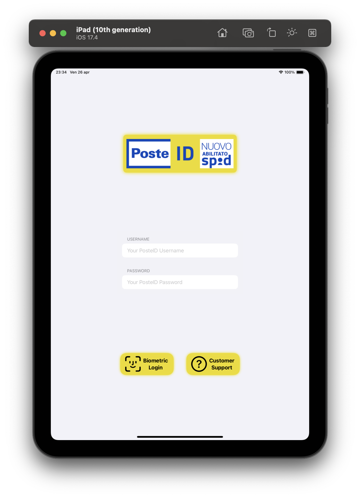
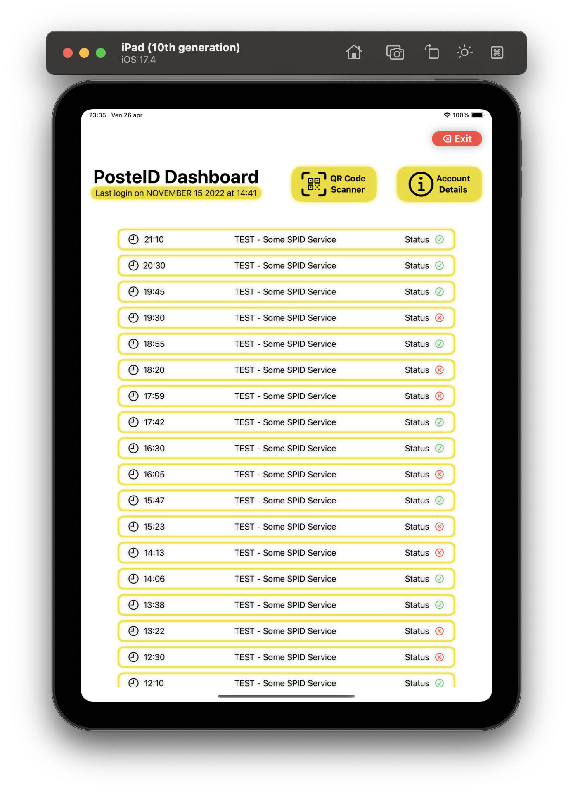

# FakePosteID

**FakePosteID** is a design-driven reinterpretation of the official PosteID app from [Poste Italiane](https://www.poste.it/), created purely as a **redesign and UI/UX exploration project**.
This is *not* a commercial product, nor is it affiliated with or endorsed by Poste Italiane S.P.A. All rights and assets related to PosteID belong to their respective owners.

---

## 🎯 Purpose

This project was originally developed as part of a **redesign challenge**, aiming to explore:

* Modern interface patterns inspired by real-world authentication apps
* Cleaner and more accessible login flows
* Updated visual language aligned with iOS and iPadOS design principles

FakePosteID is strictly a **visual and technical playground**, not intended for real identity verification.

---

## ✨ Features

* **Local authentication** (Face ID / Touch ID)
* **Redesigned login experience**
* **Modernized dashboard & profile layout**
* **Adaptive interface** optimized for both **iOS** and **iPadOS**

---

## ⚠️ Disclaimer

This project:

* does *not* implement real SPID authentication
* is not meant for production use
* is not associated in any way with Poste Italiane S.P.A.
* uses placeholder assets only for design demonstration purposes

---

## 📸 Screenshots

|               Login Page              |               Dashboard               |
| :-----------------------------------: | :-----------------------------------: |
|  |  |

